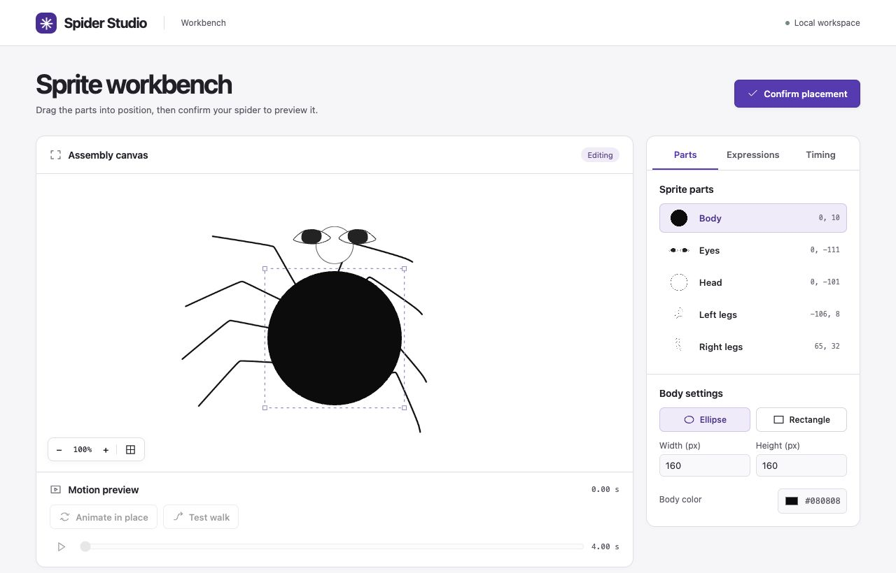

# cfghfinal-buglab

## Spider Workbench

Assemble an animated spider, customize its brush body, and preview the trail it paints. Save and open named `.spider` files with artwork, placement, timing, and action keyframes.

### Run locally

From the repository root, run `python3 -m http.server 8000 --directory dist` and open [the workbench](http://localhost:8000).

The web app and its runtime assets are in `dist/`. The original animated GIFs are in `artwork/`. To rebuild the GIF frame sheets, install Pillow and run `python3 scripts/prepare_frames.py`.

### Browser checks

Install Node.js and run `npm install`, `npx playwright install chromium`, and `npm test`.

